  

  
  
  

## Projets

  
  
  

## Technologies

  

## Expérience

| Entreprise | Poste | Période |
|---|---|---|
| **Placeme**, Toulouse | Développeur Full Stack (alternance) | mai 2025 · sept. 2026 |
| | SaaS médico-social (Angular, NestJS, GraphQL) et plateforme Airbus Helicopters en microservices | |
| **Celesty**, La Rochelle | Développeur web Shopify (CDD) | juil. 2023 · juin 2024 |
| | Boutiques Shopify et leurs versions internationales, outils internes de stock et de commandes | |

## Formation

| Diplôme | Établissement | Période |
|---|---|---|
| **Master Sciences du Logiciel** | Université de Toulouse | 2024 · 2026 |
| **Licence Informatique** | Université de La Rochelle | 2022 · 2024 |
| **Licence Informatique** | Université Nongo, Conakry | 2019 · 2022 |

## Activité

  

